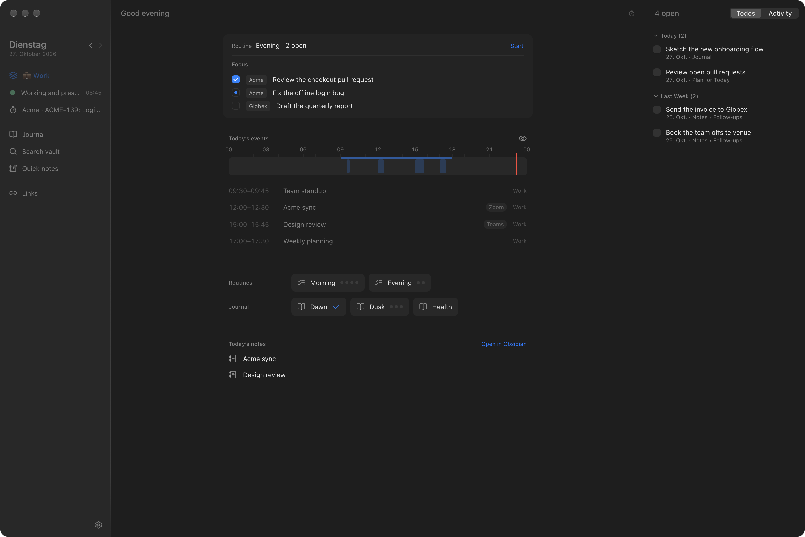
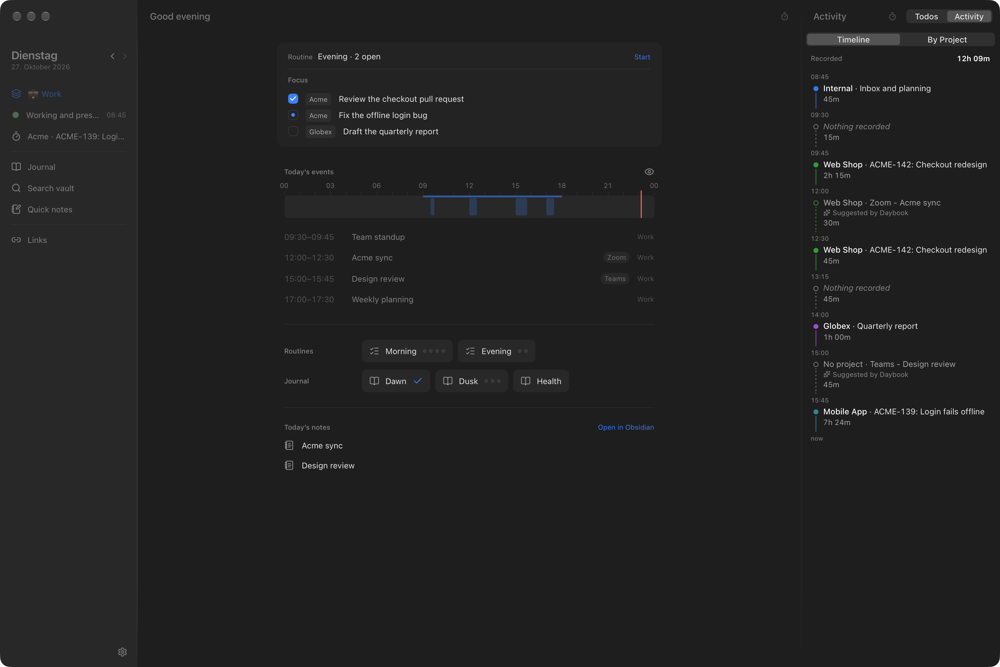
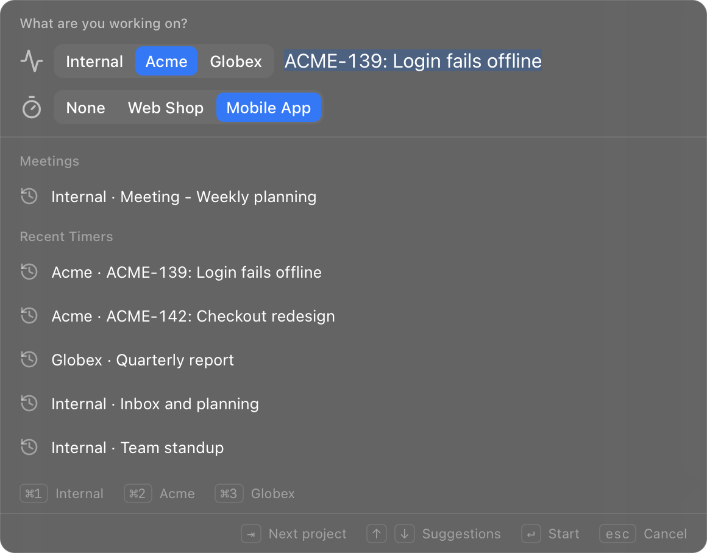
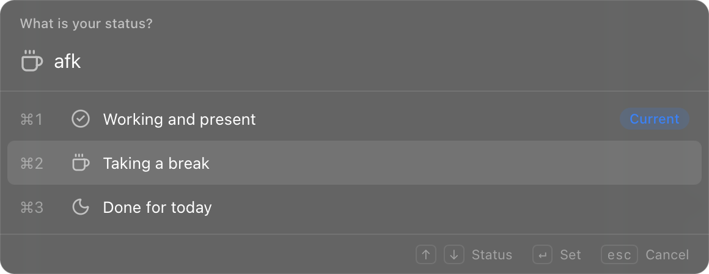
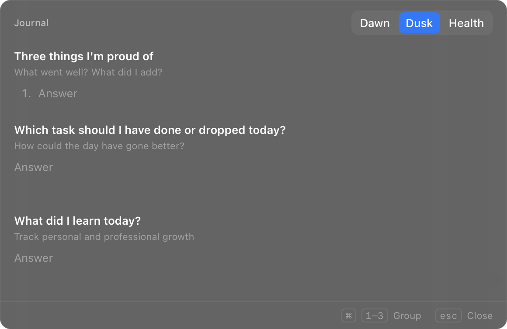

# Daybook

My menu-bar companion for my Obsidian vault. It guides my day (status, focus, routines, journal, meetings,
reminders) and gives me fast access to the vault (quick notes, search, open todos, links), while Obsidian stays
a plain editor: Daybook only adds lines to known sections of a note and never rewrites one. It does not track
time; my TimeTracker app does that, and Daybook drives it.

It is a local tool for one person on one Mac. Published as source, as-is: no releases, no binaries, no
support. To build it or port it, point a coding agent at [AGENTS.md](AGENTS.md).



## What it does

- **Status:** Working, Break and Done for today, with the Slack status to match, and TimeTracker's timer started
  or stopped along with it.
- **The day:** today's events, routines (checklists in the daily note), the daily focus, the journal and quick
  notes, all in the Daybook window and in small overlays opened by global shortcuts.
- **Activity:** what I'm working on, as a Daybook project and a note, with TimeTracker's timer picked in a second
  row. Every call during work becomes a suggestion in TimeTracker, with or without a project, and the window's
  Activity tab shows TimeTracker's day.
- **The vault:** search with a note preview, open todos across daily notes, quick-access links, Jira issues and
  Project Launcher folders.
- **Music, the rail and automation:** Apple Music playlists, a thin rail at the screen edge, the `daybook` CLI,
  `daybook://` links and a local HTTP API.



| | |
|---|---|
|  |  |
|  |  |

## Install

```sh
bun install
bun run release
```

This builds `Daybook.app`, links it into `~/Applications` and the `daybook` command into `~/.local/bin`. A
`~/.local/bin/daybook` the install didn't make (such as the prototype's script) is left alone;
`scripts/install.sh --replace-cli` replaces it. Run `scripts/create-signing-cert.sh` once per Mac first, so
macOS keeps the Accessibility and Calendar grants across rebuilds. It runs on macOS on Apple Silicon only.

## CLI

`daybook` without arguments starts Daybook or brings it to the front. Every other word asks the running app,
which knows all its commands; `--json` works everywhere, `--help` anywhere prints help and runs nothing.

| Command | Does |
|---|---|
| `daybook --hidden` | start without opening the window (launch at login uses it) |
| `daybook show` / `daybook focus` | show the window without taking focus / bring it to the front; both start Daybook if needed |
| `daybook hide` / `daybook quit` | hide the window / quit Daybook |
| `daybook status` | the version and whether the window shows (`--json` for scripts) |
| `daybook status <working\|break\|off> [note]` | set the status, with an optional note for Slack |
| `daybook slack <status> [note]` | set only the Slack status as that status would |
| `daybook state` | context, status, call, running event, music and waiting note changes as JSON |
| `daybook help [group]`, `daybook commands` | the commands, by group |
| `daybook <command words>` | any command by the words of its id: `daybook journal open`, `daybook music play Focus` |

The other words need Daybook running ("Daybook isn't running", exit 2 otherwise).

## Links and the HTTP API

`daybook://<action>?…` runs the same actions from a link: `daybook://show`, `daybook://status?status=break&note=Lunch`,
`daybook://command?id=journal:open`. A link that fails shows a notification.

With Settings → Automation → HTTP API on, `http://127.0.0.1:27180/v1/<action>` (`state`, `show`, `status`, `slack`,
`command`) answers `GET` and `POST` (JSON or form) with the token from Settings:

```sh
curl -H "Authorization: Bearer $TOKEN" http://127.0.0.1:27180/v1/state
curl -H "Authorization: Bearer $TOKEN" -d status=break -d note=Lunch http://127.0.0.1:27180/v1/status
```

## Docs

[docs/README.md](docs/README.md) is the index of the technical documentation.

## License

MIT, see [LICENSE](LICENSE).
